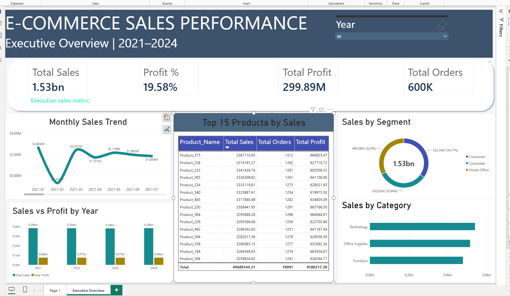

# 📊 E-Commerce Sales Performance Dashboard | Power BI

**An end-to-end business intelligence project analyzing e-commerce revenue, profitability, customer segments, product performance, and sales trends from 2021 to 2024.**


---

## 1. Project Overview

This project presents an interactive **E-Commerce Sales Performance Dashboard** developed using **Microsoft Power BI**.

The objective is to transform a large transactional sales dataset into a clear, executive-level analytical report that helps stakeholders understand business performance, identify revenue drivers, monitor profitability, and evaluate product and customer segments.

The dashboard combines data modeling, DAX calculations, time-series analysis, and interactive visualizations into a single reporting experience.

**Project highlights:**

- Approximately **600,000 sales records**
- Sales analysis covering **2021–2024**
- Star-schema-style analytical data model
- DAX measures for key business metrics
- Interactive Year filtering
- Executive KPI cards and five analytical visuals
- Product, category, customer segment, and time-based analysis

---

## 2. Dashboard Preview

### Executive Overview

The dashboard provides a consolidated view of e-commerce business performance.



*Note: The image path above assumes your screenshot is named `executive-overview.png` inside the existing `Screenshot` folder. Update the filename if your uploaded image has a different name.*

### Dashboard Components

The Executive Overview includes:

1. **Total Sales** — Overall revenue generated.
2. **Profit %** — Overall profit margin.
3. **Total Profit** — Total profit generated.
4. **Total Orders** — Distinct order count.
5. **Monthly Sales Trend** — Sales movement across months.
6. **Top 15 Products by Sales** — Leading products ranked by revenue.
7. **Sales by Customer Segment** — Revenue contribution by customer type.
8. **Sales vs Profit by Year** — Annual performance comparison.
9. **Sales by Category** — Revenue distribution across product categories.
10. **Year Slicer** — Interactive filtering by reporting year.

---

## 3. Business Problem

E-commerce businesses generate large volumes of transactional data, but raw sales records alone do not provide an accessible picture of business performance.

Management needs to answer questions such as:

- How much revenue and profit is the business generating?
- What is the overall profit margin?
- How does sales performance change over time?
- Which product categories contribute the most revenue?
- Which customer segments are most valuable by sales?
- Which products generate the highest sales?
- How do annual sales and profit compare?

This dashboard addresses these questions through an interactive business intelligence report.

---

## 4. Key Performance Indicators

The following metrics represent the overall dataset with no Year filter applied.

| KPI | Value |
|---|---:|
| **Total Sales** | **1.53B** |
| **Total Profit** | **299.89M** |
| **Total Orders** | **600K** |
| **Profit Margin** | **19.58%** |

*Figures are rounded to match the dashboard display. Currency units are not specified in the source dashboard.*

### KPI Definitions

**Total Sales:** Sum of transaction sales amounts.

**Total Profit:** Sum of transaction profits.

**Total Orders:** Distinct count of order identifiers.

**Profit Margin (%):** Total Profit divided by Total Sales, multiplied by 100.

These measures provide a consistent foundation for analyzing performance across different reporting dimensions.

---

## 5. Dataset Description

The project uses a multi-table e-commerce dataset covering sales transactions, customers, products, stores, promotions, and dates.

### Data Tables

| Table | Description | Approximate Records |
|---|---|---:|
| `FactSales` | Transaction-level sales, orders, quantities, discounts, and profits | 600,000 |
| `DimCustomers` | Customer profiles and segmentation attributes | 5,000 |
| `DimProducts` | Product details, categories, subcategories, and pricing | 500 |
| `DimStores` | Store details, location, and regional attributes | 200 |
| `DimPromotions` | Promotion-related information | 100 |
| `DimDate` | Calendar table supporting time-based reporting | Generated in Power BI |

### Important Fields

**FactSales**

- `Order_ID`
- `Order_Date`
- `Customer_ID`
- `Product_ID`
- `Store_ID`
- `Sales_Amount`
- `Profit`
- `Quantity`
- `Discount`
- `Region`

**DimCustomers**

- `Customer_ID`
- `Customer_Name`
- `Segment`
- `City`
- `State`
- `Country`

**DimProducts**

- `Product_ID`
- `Product_Name`
- `Category`
- `Sub_Category`
- `Brand`

**DimDate**

- `Date`
- `Year`
- `Quarter`
- `Year Month`
- `Month Name`
- `Month Number`

---

## 6. Data Modeling

The dashboard uses a **star-schema-style data model**.

The central `FactSales` table stores transaction-level numerical metrics, while supporting dimension tables provide descriptive attributes for filtering and analysis.

### Model Structure

```text
                    DimDate
                       |
                       |
DimCustomers ---- FactSales ---- DimProducts
                       |
                       |
                   DimStores

               DimPromotions
```

*The diagram is a conceptual overview of the model. Refer to the Power BI file for the actual configured relationships.*

### Modeling Approach

- Separate transactional facts from descriptive dimensions.
- Use customer, product, store, and date attributes to analyze sales.
- Create reusable DAX measures rather than relying on visual-specific calculations.
- Use a dedicated date table for chronological and time-based analysis.
- Maintain consistent metrics across KPI cards, charts, and tables.

---

## 7. DAX Measures

The project uses DAX to calculate and display business metrics.

### Total Sales

```dax
Total Sales =
SUM(FactSales[Sales_Amount])
```

### Total Profit

```dax
Total Profit =
SUM(FactSales[Profit])
```

### Total Orders

```dax
Total Orders =
DISTINCTCOUNT(FactSales[Order_ID])
```

### Profit Margin

```dax
Profit % =
DIVIDE(
    [Total Profit],
    [Total Sales],
    0
) * 100
```

The project also includes time-based measures such as **Year-over-Year Growth** and **Running Total Sales**.

*The expressions above illustrate the calculation logic. Exact measure definitions and formatting are maintained in the Power BI report.*

---

## 8. Dashboard Visualizations

### Monthly Sales Trend

A line chart displaying sales performance by Year-Month.

**Purpose:** Identify changes in revenue over time and compare monthly performance.

**Fields used:**
- X-axis: `DimDate[Year Month]`
- Y-axis: `[Total Sales]`

### Top 15 Products by Sales

A ranked table displaying the leading products by revenue.

**Purpose:** Identify top-performing products and compare their sales, order volume, and profitability.

**Fields used:**
- `DimProducts[Product_Name]`
- `[Total Sales]`
- `[Total Orders]`
- `[Total Profit]`

### Sales by Customer Segment

A donut chart showing sales contribution across:

- Consumer
- Corporate
- Home Office

**Purpose:** Understand how revenue is distributed across customer segments.

### Sales vs Profit by Year

A clustered column chart comparing annual sales and profit.

**Purpose:** Evaluate business growth and profitability across reporting years.

### Sales by Category

A horizontal bar chart comparing sales across:

- Technology
- Office Supplies
- Furniture

**Purpose:** Identify category-level revenue contributions.

---

## 9. Key Business Insights

### Overall Performance

The business generated approximately **1.53B in sales** and **299.89M in profit**, with an overall profit margin of **19.58%**.

This provides a high-level view of revenue generation and profitability across the reporting period.

### Customer Segment Distribution

Revenue is relatively evenly distributed across the three customer segments:

| Customer Segment | Approximate Sales Share |
|---|---:|
| Consumer | 34.77% |
| Corporate | 32.84% |
| Home Office | 32.40% |

Consumer contributes the largest share, although no single segment dominates overall sales.

### Product Performance

The Top 15 Products table identifies the highest-revenue products and allows their sales, profit, and order counts to be compared.

This helps prioritize deeper investigation into product profitability and sales concentration.

### Category Performance

The dashboard compares Technology, Office Supplies, and Furniture, making it easier to assess category-level revenue contribution.

### Time-Based Analysis

Monthly and yearly visualizations provide complementary views of performance:

- Monthly trends reveal shorter-term fluctuations.
- Annual sales-versus-profit comparisons show broader performance patterns.

**Analytical note:** These insights describe observed data patterns; they do not establish the underlying causes of sales or profit changes.

---

## 10. Tools and Technologies

| Tool / Technology | Application |
|---|---|
| Microsoft Power BI Desktop | Dashboard development |
| Power Query | Data preparation |
| DAX | Measures and calculations |
| Data Modeling | Fact and dimension table design |
| Power BI Visualizations | Interactive reporting |
| CSV | Source data format |
| GitHub | Project documentation and version sharing |

### Skills Demonstrated

- Business intelligence reporting
- KPI development
- Data modeling
- DAX calculations
- Time-series analysis
- Customer segmentation
- Product performance analysis
- Data visualization
- Analytical storytelling

---

## 11. Repository Structure

```text
ecommerce-powerbi-dashboard/
│
├── Ecommerce_Sales_Performance_Dashboard.pbix
├── data.zip
├── Screenshot/
│   └── executive-overview.png
├── README.md
└── LICENSE
```

**File descriptions**

- `Ecommerce_Sales_Performance_Dashboard.pbix` — Power BI report and analytical model.
- `data.zip` — Compressed project data.
- `Screenshot/` — Dashboard preview images.
- `README.md` — Project overview, methodology, and insights.
- `LICENSE` — Repository license.

*The screenshot filename shown above should be adjusted to match the actual uploaded file.*

---

## 12. How to Use the Dashboard

### Option 1: View the Screenshot

Open the `Screenshot` folder to preview the completed Executive Overview dashboard.

### Option 2: Open the Power BI Report

1. Download `Ecommerce_Sales_Performance_Dashboard.pbix`.
2. Install and open **Microsoft Power BI Desktop**.
3. Open the downloaded PBIX file.
4. Navigate to the Executive Overview page.
5. Use the Year slicer and visual interactions to explore the report.

### Option 3: Refresh the Dataset

If the report requires updated source paths:

1. Extract `data.zip` to a local folder.
2. Open the report in Power BI Desktop.
3. Navigate to **Transform data → Data source settings**.
4. Update the relevant file paths.
5. Refresh the data model.

*Refreshing depends on the data-source configuration saved in the PBIX file.*

---

## 13. Project Workflow

The project followed a structured analytics workflow:

**1. Data Understanding**

Reviewed sales transactions and supporting dimension tables to identify relevant business metrics and attributes.

**2. Data Preparation**

Prepared the imported data for analytical reporting using Power BI and Power Query.

**3. Data Modeling**

Organized the sales fact table and supporting dimensions into a reporting model.

**4. Measure Development**

Created DAX measures for revenue, profit, order counts, profit margin, and time-based calculations.

**5. Dashboard Development**

Built KPI cards, monthly sales trends, customer segment analysis, category comparisons, annual sales/profit comparisons, and product rankings.

**6. Validation**

Checked overall KPI results and interactive report behavior.

**7. Portfolio Documentation**

Published the project files and dashboard documentation to GitHub.

---

## 14. Future Enhancements

The next phase is to build a separate **Python-based interactive web dashboard** using the same e-commerce dataset.

### Planned Python Stack

- **Python** — Data analysis and application logic
- **Pandas** — Data processing and aggregation
- **Plotly** — Interactive charts
- **Streamlit** — Web dashboard interface
- **GitHub** — Source-code hosting
- **Streamlit Community Cloud** — Public web deployment

### Planned Features

- Modern responsive dashboard interface
- Interactive Year, Region, Category, and Segment filters
- Revenue, profit, order, and margin KPIs
- Monthly and yearly performance trends
- Product and customer segment analysis
- Downloadable filtered datasets
- Public browser-accessible dashboard

The Python implementation will be published as a separate portfolio project.

---

## 15. Project Learnings

This project strengthened my understanding of:

- Transforming raw business data into analytical reporting.
- Designing reusable DAX measures.
- Structuring a reporting model using fact and dimension tables.
- Selecting appropriate visuals for different business questions.
- Building dashboards that balance functionality and readability.
- Communicating business performance through clear KPIs and comparisons.

---

## Author

**Sombir**

GitHub: [github.com/Sombir001](https://github.com/Sombir001)

**Project:** E-Commerce Sales Performance Dashboard  
**Focus:** Data Analytics | Business Intelligence | Power BI | DAX | Data Modeling

---

*If you find this project useful, feel free to explore the repository and its Power BI report.*
